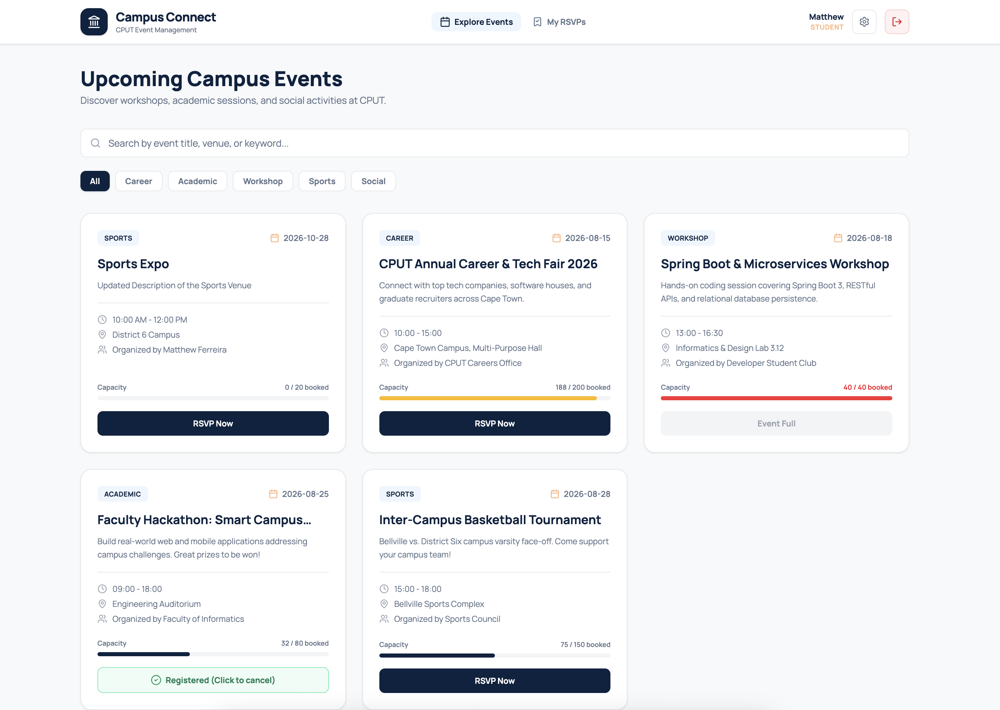

<h1>Matthew Ferreira</h1>

<strong>Applications Development Student | Java Developer</strong>

Cape Town, Western Cape &nbsp;|&nbsp; 230048870@mycput.ac.za &nbsp;|&nbsp; +27 64 519 2046

---

## About Me

Third-year **Applications Development** student at Cape Peninsula University of Technology (CPUT), specialising in Java desktop applications with database integration. I've built real-world systems including a student accommodation finder and a course enrolment platform. I care about clean code, solid OOP principles, and writing software that actually works.

Currently expanding into **Python for Machine Learning** which focuses on working with algorithms and NumPy as part of my studies.

---

## Tech Stack

### Core Skills

### Coursework / In Progress

### Also Know

---

## Project Showcase

Screenshots of the front ends of the systems I have built. Images live in the `images/` folder of this repository.

### CPUT Campus Connect
> React | Tailwind CSS | Spring Boot | MySQL | Team Project 2026 | [Code on GitHub](https://github.com/keem-sys/CPUTCampusConnect)

A full-stack web application that gives students, event organizers and administrators one searchable hub for campus events. It replaces scattered notice boards and WhatsApp groups with a dashboard, role-based access (JWT and BCrypt) and automated RSVPs that stop at venue capacity. **My role:** Interface Designer. I wrote the TypeScript for the front end.

<!-- ADD BACK WHEN SCREENSHOTS ARE UPLOADED (delete this line and the closing arrow line)
| Dashboard | Event Search and RSVP |
|---|---|
|  |  |
-->

### ResFinder
> Java | Java Swing | H2 Database | Team Project 2025 | [Code on GitHub](https://github.com/Matthew-codez/ResFinder)

A desktop application that helps students find student accommodation near campus, with search, filtering, sorting and user authentication. [EDIT: one sentence on your role.]

<!-- ADD BACK WHEN SCREENSHOTS ARE UPLOADED (delete this line and the closing arrow line)
| Login | Search Results |
|---|---|
|  |  |
-->

---

## WIL Artefacts

### Mock Interview
> Professional Development | 2026

As part of my WIL preparation I completed a mock interview covering technical skills, problem-solving, and professional communication.

  

**Questions Covered:**
- Why do you want to work for this company?
- How can your greatest strength help you in this role?
- Describe a time you had to prioritise tasks
- What is your highest level of education?
- What do you think is the biggest issue our industry faces today?

**Selection Justification (Select):**
I selected this artefact because it demonstrates my ability to communicate my skills and experiences in a professional setting.

**Reflection on Mock Interview — STAR Method:**

| | |
|---|---|
| **Situation** | As part of my WIL preparation, I was required to complete and record a mock interview to demonstrate my professional communication and readiness for the workplace. |
| **Task** | I needed to answer a set of competency and behavioural interview questions on camera, covering topics like my strengths, prioritisation, and my understanding of the industry. |
| **Action** | I prepared by reviewing each question in advance and structuring my answers around real experiences from my projects and part-time work. When asked about prioritisation, I drew on managing two team projects simultaneously alongside employment in the same semester. I recorded the interview and uploaded it to Google Drive for submission. |
| **Result** | The experience made me realise how important verbal communication is alongside technical skill. Putting my experiences into words helped me recognise growth I hadn't consciously noticed. I am now more confident articulating my value in an interview setting and understand that preparation and self-awareness are just as important as technical ability. |

---

### UML Diagram
> System Design Artefact | 2026

This UML diagram represents the structure and relationships within one of my core systems. It demonstrates my understanding of object-oriented design, class relationships, and system architecture.

- **Type:** Class Diagram
- **Tools Used:** Draw.io

**Selection Justification (Select):**
I selected this artefact because it demonstrates my understanding of system design, object-oriented principles, and class relationships.

**Reflection (Reflect):**
Creating this UML diagram helped me visualise how different components of the system interact. It reinforced my understanding of relationships such as associations, inheritance, and encapsulation. I also realised the importance of planning before coding, as a clear design makes implementation much easier and reduces errors. If I were to improve this diagram, I would simplify certain areas to improve readability and ensure scalability for larger systems.

---

## Agile Project Management Artefacts

These artefacts come from the team project **CPUT Campus Connect** (PRT362S Project III, 2026), which we delivered using Agile (Scrum) practices. Each artefact has **Evidence** (what I produced) and a **Reflection** (what I learned), following the Collect, Select, Reflect, Connect framework.

---

### Agile Team Charter

**Evidence**

> A living agreement that defines how our team works together.

| Item | Detail |
|---|---|
| **Team Name** | [EDIT: team name] |
| **Project** | CPUT Campus Connect: a campus events hub for students, organizers and admins |
| **Purpose / Vision** | Give students, faculty and clubs one searchable place to discover, promote and manage campus events, with automated RSVPs. |
| **Team Members and Roles** | Ebenezer Kouakou: Project Leader; Lisakhanya Tinae Jonga: System Analyst; Matthew Ferreira: Interface Designer; Mogamat Wazeer: Programmer; Jayden Avontuur: Database Administrator; Coben Maistry: GitHub / File Manager |
| **Core Values** | Respect, accountability, open communication, quality work |
| **Working Agreements** | Attend stand-ups; commit work in small, regular Git commits; review each other's code before merging; ask for help early rather than late |
| **Communication** | WhatsApp group for daily updates; GitHub for code and version control |
| **Definition of Done** | Feature works end to end (React front end and Spring Boot API), is committed to GitHub, and has been reviewed by one teammate |
| **Conflict Resolution** | Discuss openly as a team first; escalate to the lecturer only if unresolved |

**Reflection (STAR)**

| | |
|---|---|
| **Situation** | Our team was starting a group project with members who had different strengths and schedules. |
| **Task** | We needed to agree on how we would communicate, divide work, and handle problems before writing any code. |
| **Action** | We co-created a team charter covering our purpose, roles, values, and working agreements, and everyone contributed to it. |
| **Result** | Having expectations written down reduced confusion about who was doing what. I learned that a charter is most valuable when it is revisited, not filed away, and that agreeing on a Definition of Done early prevents arguments later. |

---

### User Stories and Tasks

**Evidence**

User stories describe features from the end user's perspective. Each story was then broken into smaller tasks.

| ID | User Story | Acceptance Criteria | Tasks |
|---|---|---|---|
| US-01 | As a **student**, I want to register and log in securely, so that my account and registrations are protected. | Valid credentials grant access via a JWT session; invalid ones show an error | Build login and register screens in TypeScript; create Users table; implement BCrypt hashing and JWT login |
| US-02 | As a **student**, I want a dashboard of upcoming events, so that I can see what is happening on campus in one place. | Upcoming events are listed with title, date, venue and capacity | Build dashboard in TypeScript; build events API endpoint; display event cards |
| US-03 | As a **student**, I want to search and filter events by keyword, category and date, so that I can find relevant events quickly. | Results update according to the chosen filters | Build search and filter bar; add filter query to the API; connect UI to the API |
| US-04 | As a **student**, I want to RSVP with one click, so that I do not need spreadsheets or forms to register. | Registration is saved; registration is blocked once capacity is reached | Add RSVP button; create Registrations table; add capacity check in the service layer |
| US-05 | As an **organizer**, I want to create, edit and delete events, so that students always see accurate information. | Event requires title, description, date, time, venue and capacity; changes are saved | Build event form in TypeScript; implement CRUD endpoints; restrict access to the Organizer role |
| US-06 | As an **admin**, I want role-based access control, so that each user type can only use the features meant for them. | Admin, Organizer and Student roles are enforced on the API | Define roles; configure Spring Security rules |

[EDIT: adjust to match your team's real stories]

**Reflection (STAR)**

| | |
|---|---|
| **Situation** | Our requirements were broad and it was unclear where to begin development. |
| **Task** | We needed to turn the idea into clear, testable pieces of work that could be shared across the team. |
| **Action** | We wrote user stories in the "As a... I want... so that..." format, added acceptance criteria, and split each story into technical tasks. |
| **Result** | Thinking from the user's perspective kept us focused on value rather than just code. Breaking stories into tasks made estimating and assigning work much easier, and I learned that a story without acceptance criteria is hard to call "done". |

---

### Product Backlog

**Evidence**

The product backlog is the prioritised list of everything the product needs. Priority uses MoSCoW (Must, Should, Could, Won't) and estimates are in story points.

| ID | Backlog Item | Type | Priority | Points | Status |
|---|---|---|---|---|---|
| PB-01 | User registration and login (BCrypt and JWT) | Feature | Must | 8 | Done |
| PB-02 | Role-based access control (Admin, Organizer, Student) | Feature | Must | 5 | Done |
| PB-03 | Events dashboard for upcoming events | Feature | Must | 5 | Done |
| PB-04 | Organizer event CRUD | Feature | Must | 8 | In Progress |
| PB-05 | Keyword, category and date filtering | Feature | Should | 5 | In Progress |
| PB-06 | One-click RSVP with capacity limit | Feature | Must | 8 | In Progress |
| PB-07 | Fix dashboard crash when no events exist | Bug | Should | 2 | Not Started |
| PB-08 | Email reminders for registered events | Feature | Could | 13 | Not Started |

[EDIT: adjust statuses to match your real progress]

**Reflection (STAR)**

| | |
|---|---|
| **Situation** | We had more ideas than time available to build them. |
| **Task** | We needed to decide what to build first so the most valuable features were delivered. |
| **Action** | We collected all features, bugs, and improvements into one backlog, ranked them with MoSCoW, and estimated each in story points. |
| **Result** | The backlog made trade-offs visible: nice-to-have items like the map view were consciously postponed. I learned that a backlog is never "finished" and needs regular re-prioritisation. |

---

### Sprint Backlog

**Evidence**

**Sprint 1:** [EDIT: dd Mon] to [EDIT: dd Mon]
**Sprint Goal:** Deliver secure registration and login, and an events dashboard connected to the MySQL database.

| Task | Linked Story | Owner | Estimate | Status |
|---|---|---|---|---|
| Build login and register screens (TypeScript) | US-01 | Matthew | 3h | Done |
| Create Users table in MySQL | US-01 | Jayden | 1h | Done |
| Implement BCrypt hashing and JWT login | US-01 | Mogamat | 4h | Done |
| Build events dashboard (TypeScript) | US-02 | Matthew | 3h | Done |
| Build events API endpoint | US-02 | Mogamat | 3h | Done |
| Display event cards from API data (TypeScript) | US-02 | Matthew | 3h | Done |

**Reflection (STAR)**

| | |
|---|---|
| **Situation** | With a fixed deadline, we could not work on the entire product backlog at once. |
| **Task** | We had to choose a realistic amount of work for each sprint and commit to a clear goal. |
| **Action** | In sprint planning we pulled the highest-priority items from the product backlog, defined a sprint goal, and broke the work into hour-level tasks with owners. |
| **Result** | A short, focused sprint kept the team aligned and made progress easy to see on the board. I learned that over-committing leads to unfinished work, so estimates need to be honest. |

---

### Agile Logbook

**Evidence**

A record of our stand-ups, sprint planning, and retrospective.

| Date | Type | What Was Done | Blockers / Notes |
|---|---|---|---|
| [EDIT] | Sprint Planning | Agreed the sprint goal and selected backlog items | Needed to agree on the database structure |
| [EDIT] | Daily Stand-up | Login and register screens built; Users table created | None |
| [EDIT] | Daily Stand-up | JWT login implemented; dashboard started | Merge conflict on GitHub, resolved together |
| [EDIT] | Daily Stand-up | Events endpoint working; front end connected to the API | Dashboard failed when there were no events (logged as PB-07) |
| [EDIT] | Sprint Review | Demonstrated login and dashboard to the team | Feedback: clearer error messages |
| [EDIT] | Retrospective | **Went well:** clear roles, small commits. **Improve:** estimate more accurately, test earlier | Action: test each feature before marking it Done |

**Reflection (STAR)**

| | |
|---|---|
| **Situation** | Work was happening quickly across several people, and it was easy to lose track of decisions and problems. |
| **Task** | We needed a consistent record of progress, blockers, and lessons learned. |
| **Action** | We logged each stand-up, the sprint review, and the retrospective, noting what was done, what blocked us, and what we would change. |
| **Result** | The logbook gave us a clear history and made the retrospective meaningful because we could look back at real events. I learned that regular, honest reflection improves the next sprint more than any tool does. |

---

## Reflection on Coding in Markdown — STAR Method

| | |
|---|---|
| **Situation** | As part of my WIL digital portfolio submission, I was required to build and present my portfolio using Markdown on GitHub. |
| **Task** | I needed to learn and apply GitHub Flavoured Markdown (GFM) to structure my CV, projects, and reflections in a readable, professional format suitable for a developer portfolio. |
| **Action** | I researched GFM syntax and practised using headings, tables, badges, bullet points, and links. I structured my entire portfolio in a single README.md file, using Markdown to organise sections clearly and embed shields for my tech stack. I also used HTML elements like `
` where Markdown alone was not sufficient. |
| **Result** | I produced a well-structured, visually clear portfolio entirely in Markdown. This experience taught me that Markdown is a core developer communication tool — used daily in README files, pull requests, and documentation. I now feel confident writing and maintaining Markdown files in any professional or academic context. |

---

## Reflection on GitHub Pages — STAR Method

| | |
|---|---|
| **Situation** | My digital portfolio needed to be publicly accessible online as a requirement of the POE submission, rather than existing only as a private repository. |
| **Task** | I needed to deploy my GitHub portfolio to GitHub Pages so that it could be viewed at a live URL and submitted as a link on Blackboard. |
| **Action** | I enabled GitHub Pages in my repository settings, selected the correct branch and root directory, and verified that my README.md rendered correctly as a public page. I checked that all links, badges, and embedded content displayed as intended on the live site. |
| **Result** | My portfolio is now publicly deployed and accessible via a `github.io` URL. This process taught me the basics of static site deployment and reinforced the value of GitHub as a professional tool beyond just version control. Knowing how to publish work publicly is a practical skill I will carry into my career. |

---

## Connection of Learning (Connect)

Across my studies, I can clearly see my development from building basic Java applications to designing more complex systems involving client-server architecture and database integration. These experiences are connected through principles such as object-oriented programming, separation of concerns, and database interaction. Each stage built on the previous one, strengthening my ability to design scalable and maintainable systems. Working in Agile sprints added a process layer to this progression: user stories, backlogs, and retrospectives taught me how to plan and deliver software as a team, not just write it.

My current work with Python and machine learning represents the next stage of this progression, expanding my problem-solving skills into data-driven applications.

---

## Graduate Attributes

### Ubuntu — People, Interpersonal & Interprofessional Skills
In team-based work I have collaborated alongside classmates with different strengths and working styles. I made sure to communicate progress openly and deliver on time so teammates would not be blocked. I understand that software development is rarely a solo effort and the quality of the end product depends on how well the team works together.

### Knowing, Technological Capability & Foresight
Through my studies I applied Java, database design, and software architecture principles to solve real problems that students at institutions like CPUT face. My expansion into Python and machine learning reflects my awareness that the technology landscape is always shifting and I need to grow with it.

### Resilience & Problem-Solving Capability
In third year I managed coursework and collaborative work alongside a part-time job. I proactively mapped out my deadlines at the start of semester and made a decision to tackle higher-priority work first, which kept everything on track.

### Ethical Capability & Respect
In all group work I ensured that contributions were credited fairly and that no teammate's work was misrepresented. I believe good software also means honest software — not overstating what a system can do, writing code that is maintainable for whoever comes after you, and being transparent about limitations. In my mock interview preparation I was deliberate about only claiming skills I can genuinely back up.

---

## Goals & Timeline

| Goal | Target Date | Status |
|---|---|---|
| Complete Naïve Bayes ML project | Mid 2026 | In Progress |
| Complete WIL mock interview | 2026 | Done |
| Finalise Digital Portfolio (POE) | 2026 | Done |
| Complete Agile artefacts (Charter, Backlogs, Logbook) | 2026 | Done |
| Graduate with Diploma in Applications Development | 2026 | On Track |
| Secure first developer role (Java / Backend) | 2026/2027 | Upcoming |

---

## Education

| Qualification | Institution | Year |
|---|---|---|
| Diploma: ICT in Applications Development | Cape Peninsula University of Technology | Expected 2026 |
| Higher Certificate in ICT | NorthLink College | 2023 |
| National Senior Certificate (Grade 12) | J.G. Meiring High School | 2022 |

---

## Languages

- **English** – Native
- **Afrikaans** – Fluent

---

Built with Markdown · Deployed on GitHub Pages · Cape Peninsula University of Technology · 2026

